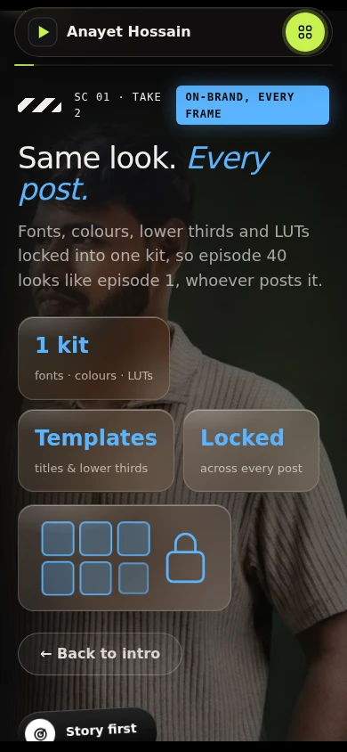
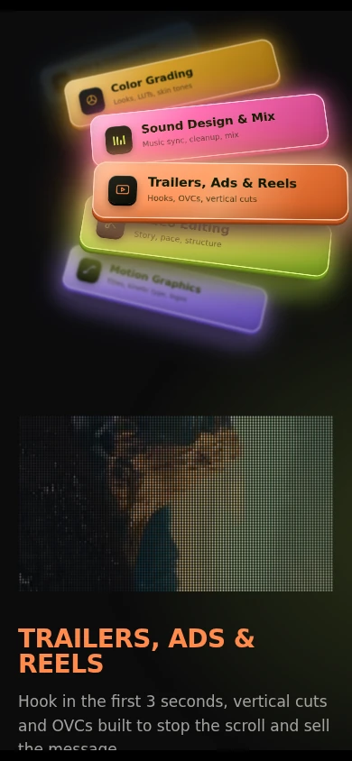

# Mobile interaction verification — 1 November 2026

Baseline: `7951fe9ff7b4cd6f37ac4dc0ad47823ba10d8086` (the main-branch follow-up to the visual update `b12bf784`). Changes are on `fix/mobile-interactions`; production is not deployed by this review branch.

## Reproduced defects and fixes

| Problem | Reproduction on the baseline | Fix |
| --- | --- | --- |
| All four mobile explanations are unreachable | At 390×844, the four floating cards are hidden. Tapping their remaining pill labels does nothing: they are spans with no handler. | Native pill buttons open the same four details, report expanded state, bring the detail below the fixed navigation, and restore focus on Back. Existing desktop artwork and mobile pill styling remain. |
| Desktop headline intercepts card clicks | At 1440×900, the intro text intercepts the center click on the “Built to retain” card. | Let pointer events pass through the headline. The section still receives mouse movement for its letter/trail effect. |
| Resizing loses mobile controls | Enter the desktop scene, wait for `.landed`, then resize to 390px. The cards disappear and the pill group retains opacity 0 and height 0. | Narrow-screen CSS restores the pills even after the desktop launch state. |
| Reduced-motion drawings disappear or keep moving | With reduced motion enabled before load, open Story using the keyboard: its path retains a 420px dash offset and its SVG `animateMotion` remains. The brand scene's six tiles have opacity 0. | Static visible path/tile end states; omit the story's SVG motion element for reduced motion. |
| Reduced-motion Resume button does nothing | At the reel, press Resume auto-play. Its label changes to Pause, but the project stays unchanged after 7.2 seconds because no interval was registered. | Register the timer in both modes, starting paused under reduced motion. Explicit Resume works; manual navigation remains available. |
| Service selection changes while still focused | At 768×1024 with normal motion, tap Video Editing and scroll to its LED display. The title/playing clip switches to Motion Graphics while Video Editing remains the focused element: mouse-leave cleared the shared focus/hover pause flag. | Check hover and focus independently; retain the chosen service while its card has focus. Apply the same independent focus check to the reel timer. |

Also added document-visibility handling: service clips pause on a hidden-document signal and resume only the selected clip when visible. The reel timer also checks document visibility. The automated lifecycle check simulates this signal; it does not establish OS background behavior on a phone.

## Completed checks

A local HTTP server with byte-range support served the actual HTML and assets. Playwright controlled a real headless Chromium 153 engine. Mobile cases use mobile viewport emulation and touch input; these are **not physical Android or iOS tests**. Desktop live-site inspection was also performed through the cloud Chrome browser, but that browser did not expose mobile emulation controls. All patched interactions were validated locally, not on the production deployment.

| Viewport | Normal motion | Reduced motion |
| --- | --- | --- |
| 320×568 | Passed | Passed |
| 390×844 | Passed | Passed |
| 430×932 | Passed | Passed |
| 844×390 | Passed | Passed |
| 768×1024 | Passed | Passed |
| 1024×768 | Passed | Passed |
| 1440×900 desktop regression | Passed | Passed |

Each scenario exercises all four explanations and Back/focus return; menu open/close; previous/next reel buttons; featured-project tab/card changes; player open/close; all six service selections; all five local MP4 decodes and visible LED canvas pixels; the sound equalizer; offscreen video pausing; and page-width overflow. The touch scenarios use real browser-generated touch input, including a horizontal swipe and the resulting click sequence, and assert that a swipe does not accidentally open the player. Normal playback checks advance media time and permit at most one playing clip. Reduced-motion cases check paused still frames, visible drawings, and absence of SVG motion. The 390px reduced-motion scenario verifies explicit Resume. Service checks assert that the focused selection stays selected while its preview plays. Desktop scenarios additionally exercise card hit targets, mouse tilt, and desktop-to-mobile resizing. No uncaught page JavaScript errors were recorded.

No missing local media was found during the exercised loading paths. The first local playback probe used an HTTP server without byte ranges and produced an invalid seek result. After correcting the server, the baseline's reduced-motion seek worked; no seek/playback-attribute change was retained.

Screenshots of the patched 390px normal-motion page:





## Run the regression checks

```sh
npm ci
npx playwright install chromium
npm run test:mobile
```

For an existing Chromium installation, set `CHROMIUM_EXECUTABLE_PATH`. Optional `TEST_SIZE=390x844`, `TEST_MOTION=reduce`, and `SCREENSHOT_DIR=/absolute/path` narrow the run or capture evidence. The test server is ephemeral; no public server or production deployment is needed. The test instruments off-DOM video creation to inspect media state; application code has no test hooks. Continuously bobbing cards are tested at visible, hit-tested coordinates instead of disabling their animations.

## Still requires physical devices / other engines

- Safari on an actual iPhone and Chrome on an actual Android phone: muted inline autoplay, service switching, and whether OS power/data saving restricts playback.
- Lock/unlock, background/foreground, incoming interruptions, and returning after the browser discards the tab.
- Real rotation, browser address-bar expansion/collapse, notches/safe areas, rapid repeated gestures, multi-touch, and vertical scrolling beginning over the reel.
- Phone GPU/frame pacing, memory use, heat, and battery cost of the LED/dot effects during prolonged use.
- Google Drive's embedded project playback, authentication/access behavior, and external full-screen controls. The local tests verify the portfolio opens/closes its player, not that third-party hosted videos play end to end.
- Reduced-motion preference changes while a page is already open. The completed matrix sets the preference **before navigation**.

WebKit/iOS and Firefox were not executed in this environment. Mobile emulation cannot establish performance or media policy on physical devices.
